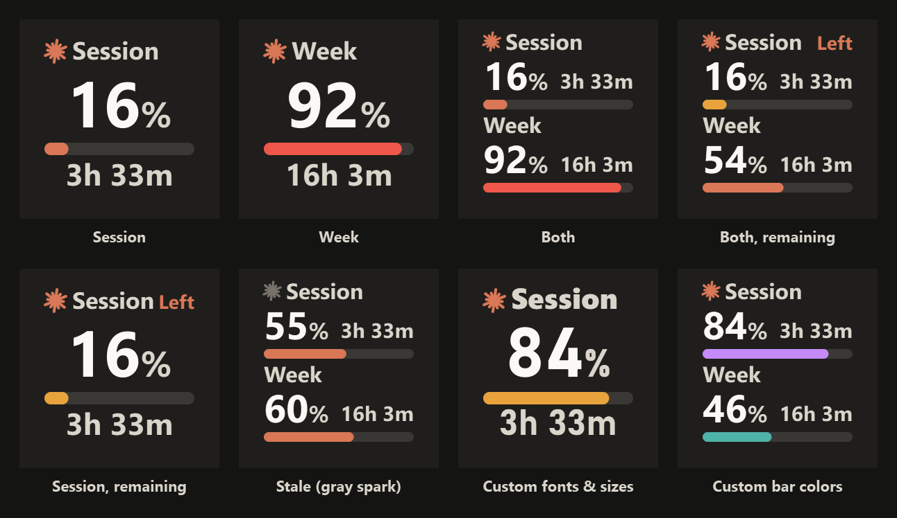

# Claude Limits for Stream Deck

[English](#english) | [日本語](#日本語)

---

<a id="english"></a>

## English

Shows how much of your Claude usage limits is left on a Stream Deck key: the session window (5 hours) and the weekly window (7 days), each with a bar and a countdown to its reset. Windows only.



> The images above are rendered with the same Qt SVG engine Stream Deck uses, with sample numbers.

### Features

- **Session / Week** — one window per key: spark and label, a big percentage, a thin bar and the time until reset.
- **Both** — Session and Week stacked on one key.
- **Used / remaining** — show the used percentage (like the official usage page) or what is left; remaining mode adds a small 残 ("remaining") tag so the two cannot be confused. The tag can be changed to "Left" or switched off in the key's settings.
- **Readable on the key** — everything is bold, the content stays inside an inner band so the bezel does not hide it, and the percentage turns amber from 70% and red from 90%.
- **Fonts and sizes per element** — pick a font and a size (70–150%) separately for the header, the percentage and the countdown in the key's settings.
- **Clearly Claude** — an orange spark, drawn from scratch for this plugin, marks the key. The spark turns gray while the numbers shown are from the last successful fetch.
- Press the key to refresh right away. Otherwise values are fetched every 5 minutes (backing off up to 30 minutes if the endpoint rate limits).

### Requirements

- Windows 10 or later, Stream Deck 6.6 or later
- Claude Code signed in on this PC (`claude` → `/login`), so that `~/.claude/.credentials.json` exists

### How it works

The plugin reads your Claude Code login from `%USERPROFILE%\.claude\.credentials.json` (or `$CLAUDE_CONFIG_DIR`) and asks `https://api.anthropic.com/api/oauth/usage` for your usage. Nothing else is sent anywhere, and there is no telemetry.

When Claude Code runs inside the Claude desktop app, the access token in that file is not refreshed and expires within hours. So when the token has expired the plugin refreshes it the same way the Claude Code CLI does (with the refresh token, against `https://platform.claude.com/v1/oauth/token`) and writes the new tokens back to the file. The `claude` CLI keeps working with the same file.

If a key says "未ログイン" or "要ログイン" (not signed in / sign in again), run `claude` in a terminal and `/login`.

> **Heads up**
> - The usage endpoint is not a documented public API and can change or stop working at any time.
> - The plugin signs in with Claude Code's own OAuth client ID, and it modifies your credentials file when refreshing. Use it only with your own account and understand that trade-off.
> - The endpoint is rate limited per account. Other tools that poll it with the same login count too, so running several usage plugins together can lead to a "rate limited" key.

### Install from source

Needs Node.js 20+ and the [Stream Deck CLI](https://docs.elgato.com/streamdeck/sdk/introduction/getting-started).

```bash
npm install
npm run build
streamdeck link com.hymnk.claudelimits.sdPlugin
streamdeck restart com.hymnk.claudelimits
```

- `npm run preview` — write every layout and state to `dist/preview.html` and `dist/svg/`
- `python scripts/qt-render.py` — render `dist/svg/` with Qt's SVG engine into `dist/qt-preview.png` (needs `pip install PySide6-Essentials`). Browsers and Qt treat fonts differently, so use this for the final check.
- `python scripts/make-screenshots.py` — rebuild `docs/keys.png`
- `npm run icons` — regenerate the icons
- `streamdeck pack com.hymnk.claudelimits.sdPlugin` — create a `.streamDeckPlugin`

### Disclaimer

This is an unofficial, community project. It is not affiliated with, endorsed by or sponsored by Anthropic or Elgato. "Claude" and "Anthropic" are trademarks of Anthropic, PBC. "Stream Deck" and "Elgato" are trademarks of their respective owners. The spark icon is an original drawing, not Anthropic's logo.

### License

MIT

---

<a id="日本語"></a>

## 日本語

Claude の利用枠の使用率を Stream Deck のキーに表示するプラグインです。Session(5時間枠)と Week(7日枠)について、バーとリセットまでの残り時間を表示します。Windows 専用です。


> 上の画像は、Stream Deck と同じ Qt の SVG エンジンで描画したものです(数値はサンプル)。

### 特長

- **Session / Week** — 1キーに1つの枠を表示します。スパークとラベル、大きなパーセント、細いバー、リセットまでの時間が並びます。
- **両方** — 1キーに Session と Week を2段で表示します。
- **使用率 / 残量** — 公式の使用状況ページと同じ「使用率」と、「残量」を切り替えられます。残量表示では小さな「残」マークが付き、取り違えを防ぎます(キーの設定で「Left」への変更や非表示もできます)。
- **実機で読みやすい** — 文字はすべて太字で、キーの縁に隠れないよう内側に収めています。パーセントは70%以上で黄、90%以上で赤になります。
- **要素ごとのフォントと大きさ** — キーの設定で、見出し・パーセント・残り時間それぞれのフォントと大きさ(70〜150%)を選べます。
- **Claude だとひと目で分かる** — オレンジのスパーク(このプラグイン用に描き起こしたもの)が目印です。直前に取得した値を表示しているときは、スパークがグレーになります。
- キーを押すとすぐ再取得します。通常は5分ごとに取得し、取得制限にかかったときは最大30分まで間隔を延ばします。

### 必要なもの

- Windows 10 以降、Stream Deck 6.6 以降
- この PC で Claude Code にログイン済みであること(`claude` を起動して `/login`)。`~/.claude/.credentials.json` が必要です。

### 仕組み

Claude Code のログイン情報を `%USERPROFILE%\.claude\.credentials.json`(`CLAUDE_CONFIG_DIR` があればそちら)から読み、`https://api.anthropic.com/api/oauth/usage` から利用状況を取得します。それ以外の送信やテレメトリはありません。

Claude デスクトップアプリ内で Claude Code を使っていると、このファイルのアクセストークンは更新されず、数時間で期限切れになります。そのためプラグインは、期限切れのときに Claude Code CLI と同じ方法(リフレッシュトークンを `https://platform.claude.com/v1/oauth/token` に送る)でトークンを更新し、新しいトークンをファイルに書き戻します。CLI 版の `claude` も同じファイルをそのまま使えます。

キーに「未ログイン」「要ログイン」と出たときは、ターミナルで `claude` を起動して `/login` してください。

> **ご注意**
> - 利用状況のエンドポイントは公開仕様のある API ではなく、予告なく変更・停止される可能性があります。
> - Claude Code 用の OAuth クライアント ID でトークンを更新し、更新時に認証ファイルを書き換えます。ご自身のアカウントでのみ、この点を理解したうえで使ってください。
> - エンドポイントはアカウント単位で取得回数が制限されています。同じログイン情報で取得する他のツールも数えられるため、利用状況プラグインを複数並べると「取得制限中」と表示されることがあります。

### ソースからのインストール

Node.js 20 以降と [Stream Deck CLI](https://docs.elgato.com/streamdeck/sdk/introduction/getting-started) が必要です。

```bash
npm install
npm run build
streamdeck link com.hymnk.claudelimits.sdPlugin
streamdeck restart com.hymnk.claudelimits
```

- `npm run preview` — 全レイアウト・状態のキー画像を `dist/preview.html` と `dist/svg/` に出力します。
- `python scripts/qt-render.py` — `dist/svg/` を Stream Deck と同じ Qt の SVG エンジンで描画し、`dist/qt-preview.png` に出力します(`pip install PySide6-Essentials` が必要)。ブラウザと Qt ではフォントの解釈が違うため、最終確認はこちらで行います。
- `python scripts/make-screenshots.py` — `docs/keys.png` を作り直します。
- `npm run icons` — アイコン画像を再生成します。
- `streamdeck pack com.hymnk.claudelimits.sdPlugin` — 配布用の `.streamDeckPlugin` を作成します。

### 免責

これは非公式のコミュニティ製プロジェクトで、Anthropic 社および Elgato 社とは提携・後援・承認の関係にありません。「Claude」「Anthropic」は Anthropic, PBC の商標、「Stream Deck」「Elgato」はそれぞれの権利者の商標です。スパークのアイコンは独自に描いたもので、Anthropic 社のロゴではありません。

### ライセンス

MIT
